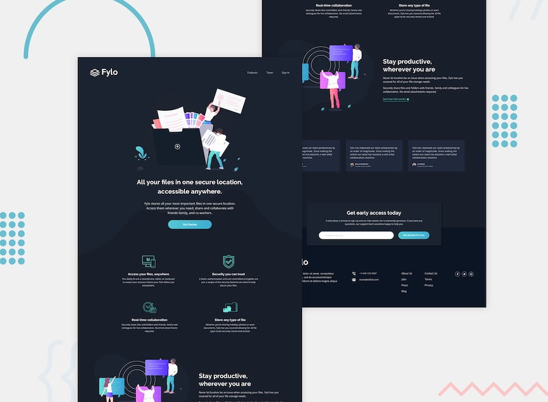

# Frontend Mentor - Página de aterrizaje (landing page) de Fylo (tema oscuro)

## ¡Bienvenido/a! 👋

Gracias por echar un vistazo a este desafío de programación front-end.

Los desafíos de [Frontend Mentor](https://www.frontendmentor.io) te ayudan a mejorar tus habilidades de programación mediante la creación de proyectos realistas.

**Para realizar este desafío, necesitas tener conocimientos básicos de HTML y CSS.**

## El desafío

Tu objetivo es desarrollar esta página de aterrizaje (landing page) y lograr que su apariencia sea lo más fiel posible al diseño original.

Puedes utilizar las herramientas que prefieras para completar el desafío; así que, si hay algo que te gustaría practicar, ¡no dudes en ponerlo en práctica!

Los usuarios deberían poder:

- Visualizar la disposición (layout) óptima del sitio según el tamaño de pantalla de su dispositivo.
- Ver los estados al pasar el cursor (hover) en todos los elementos interactivos de la página.

### ¿Necesitas ayuda con el desafío?

[Únete a nuestra comunidad](https://www.frontendmentor.io/community) y plantea tus dudas en el canal **#help**.

## ¿Dónde encontrar los recursos?

Tu tarea consiste en desarrollar el proyecto siguiendo los diseños que se encuentran en la carpeta `/design`. Allí hallarás versiones tanto para dispositivos móviles como para escritorio.

Los diseños están en formato JPG estático. Al tratarse de archivos JPG, deberás aplicar tu propio criterio para determinar valores como el tamaño de fuente (`font-size`), el relleno (`padding`) y los márgenes (`margin`).

Si deseas obtener el archivo de diseño de Figma para examinarlo con mayor detalle, puedes [suscribirte como miembro PRO](https://www.frontendmentor.io/pro).

Encontrarás todos los recursos necesarios en la carpeta `/images`. Estos recursos ya están optimizados.

También hay un archivo llamado `style-guide.md` que contiene información relevante, como la paleta de colores y las tipografías.

## Uso de asistentes de programación basados ​​en IA

Hemos incluido dos archivos para ayudarte en caso de que utilices asistentes de programación basados ​​en IA (como Claude, GitHub Copilot, Cursor, etc.) mientras trabajas en este desafío:

- `AGENTS.md`: contiene instrucciones detalladas para los asistentes de IA sobre cómo apoyarte en este desafío. El contenido está adaptado al nivel de dificultad del ejercicio, de modo que la IA te ofrecerá una orientación adecuada a tu etapa de aprendizaje: brindando más apoyo en los desafíos para principiantes y fomentando una mayor autonomía en los de nivel avanzado.
- `CLAUDE.md`: un archivo de referencia que dirige a las herramientas basadas en Claude hacia las instrucciones contenidas en `AGENTS.md`.

**¿Cómo utilizarlos?** ¡No tienes que hacer nada! La mayoría de las herramientas de programación basadas en IA detectan estos archivos automáticamente. La IA los leerá y ajustará su comportamiento para convertirse en un mejor compañero de aprendizaje, guiándote hacia las soluciones en lugar de simplemente darte las respuestas.

**Nota:** Estos archivos están diseñados para ayudarte a *aprender*, no para realizar el trabajo por ti. La IA tiene instrucciones de plantear preguntas, ofrecer pistas y explicar conceptos, en lugar de escribir soluciones completas.

## Desarrollo de tu proyecto

Puedes utilizar el flujo de trabajo con el que te sientas más cómodo. A continuación, te sugerimos un proceso, aunque no es obligatorio seguir estos pasos:

1. Inicializa tu proyecto como un repositorio público en [GitHub](https://github.com/). Crear un repositorio facilitará que compartas tu código con la comunidad si necesitas ayuda. Si no sabes cómo hacerlo, [consulta este recurso de "Try Git"](https://try.github.io/).
2. Configura tu repositorio para publicar tu código en una dirección web. Esto también te será útil si necesitas ayuda durante un desafío, ya que puedes compartir la URL de tu proyecto junto con la URL de tu repositorio. Existen varias formas de hacerlo; a continuación, te ofrecemos algunas recomendaciones.
3. Revisa los diseños para empezar a planificar cómo abordarás el proyecto. Este paso es fundamental para anticipar qué clases CSS necesitarás y así crear estilos reutilizables.
4. Antes de añadir cualquier estilo, estructura el contenido mediante HTML. Escribir primero el HTML te ayudará a centrarte en crear un contenido bien estructurado.
5. Define los estilos base de tu proyecto, incluidos los estilos generales para el contenido, como `font-family` y `font-size`.
6. Comienza a añadir estilos desde la parte superior de la página y avanza hacia abajo. No pases a la siguiente sección hasta que estés satisfecho con el trabajo realizado en el área en la que te encuentras.

## Publicación de tu proyecto

Como se mencionó anteriormente, existen muchas formas de alojar tu proyecto de manera gratuita. Nuestras opciones recomendadas son:

- [GitHub Pages](https://pages.github.com/)
- [Vercel](https://vercel.com/)
- [Netlify](https://www.netlify.com/)

Puedes alojar tu sitio utilizando una de estas opciones o cualquier otro proveedor de confianza. [Lee más sobre nuestros servicios de alojamiento recomendados y de confianza](https://www.frontendmentor.io/guides/hosting-your-solution).

## Creación de un archivo `README.md` personalizado

Te recomendamos encarecidamente que sustituyas este archivo `README.md` por uno personalizado. Hemos incluido una plantilla en el archivo [`README-template.md`](./README-template.md) dentro de este código inicial.

La plantilla sirve como guía sobre qué información incluir. Un archivo `README` personalizado te ayudará a explicar tu proyecto y a reflexionar sobre lo que has aprendido. Siéntete libre de modificar nuestra plantilla tanto como desees.

Una vez que hayas añadido tu información a la plantilla, elimina este archivo y cambia el nombre de `README-template.md` a `README.md`. De este modo, aparecerá como el archivo `README` de tu repositorio.

## Envío de tu solución

Envía tu solución a través de la plataforma para que el resto de la comunidad pueda verla. Consulta nuestra ["Guía completa para enviar soluciones"](https://www.frontendmentor.io/guides/how-to-submit-solutions) para obtener consejos sobre cómo hacerlo.

Recuerda que, si buscas recibir comentarios sobre tu solución, no olvides plantear preguntas al realizar el envío. Cuanto más específicas y detalladas sean tus preguntas, mayores serán las probabilidades de obtener aportes valiosos por parte de la comunidad.

## Cómo compartir tu solución

Existen varios lugares donde puedes compartir tu solución:

1. Comparte la página de tu solución en el canal **#finished-projects** de la [comunidad](https://www.frontendmentor.io/community).
2. Compártela en [X (anteriormente Twitter)](https://x.com/frontendmentor) mencionando a **@frontendmentor** e incluyendo los enlaces al repositorio y a la versión en vivo (live URL) en tu publicación. Nos encantará ver lo que has creado y ayudarte a difundirlo.
3. Comparte tu solución en [LinkedIn](https://www.linkedin.com/company/frontend-mentor/).
4. Escribe un artículo en un blog sobre tu experiencia al desarrollar el proyecto. Hablar sobre tu flujo de trabajo, tus decisiones técnicas y explicar tu código es una forma excelente de reforzar lo que has aprendido. Algunas plataformas ideales para publicar son [dev.to](https://dev.to/), [Hashnode](https://hashnode.com/) y [CodeNewbie](https://community.codenewbie.org/).

Ofrecemos plantillas para ayudarte a compartir tu solución una vez que la hayas enviado a la plataforma. No dudes en editarlas e incluir preguntas específicas cuando busques recibir comentarios.

Cuanto más concretas sean tus preguntas, más probabilidades tendrás de que otros miembros de la comunidad te ofrezcan su opinión.

## ¿Tienes sugerencias para nosotros?

¡Nos encanta recibir comentarios! Siempre buscamos mejorar nuestros desafíos y nuestra plataforma. Si hay algo que te gustaría comentarnos, por favor envía un correo electrónico a hi[at]frontendmentor[dot]io.

Este desafío es totalmente gratuito. ¡Compártelo con cualquier persona a quien pueda resultarle útil para practicar!

**¡Disfruta creando!** 🚀